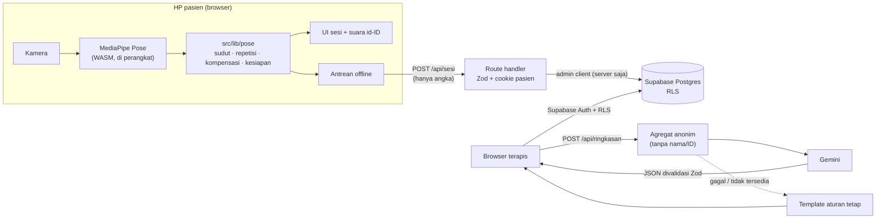

# GerakPulih

**Kamera HP yang menemani latihan lengan pasien pasca-stroke di rumah, dan angka latihannya langsung terlihat oleh fisioterapis.**

> Karya lomba Web Development IT RUSH 2026 · Tim **Abis PIMNAS gatau mau ngapain**

| | |
|---|---|
| **Demo** | **https://gerakpulih-itrush26-xsri.vercel.app** |
| **Sisi terapis** | [`/masuk`](https://gerakpulih-itrush26-xsri.vercel.app/masuk) → tombol **Coba dengan akun demo** (tanpa mengetik email/sandi) |
| **Sisi pasien** | Di HP, buka [`/mulai/demo-budi`](https://gerakpulih-itrush26-xsri.vercel.app/mulai/demo-budi) di **Chrome**, atau tombol **Coba demo** di landing (ada QR untuk dipindai dari laptop) |

Untuk mencoba sisi pasien: izinkan kamera, letakkan HP tegak setinggi dada sekitar 1,5–2 m dari kursi, lalu ikuti panduan suara. Video tidak pernah keluar dari HP. Untuk kembali, pakai **Keluar dari demo** di beranda pasien.

---

## Masalah

Setelah pulang dari rumah sakit, pasien pasca-stroke melanjutkan latihan lengan sendiri di rumah. Keluarga tidak tahu apakah gerakannya sudah benar dan cukup tinggi. Fisioterapis tidak tahu apakah latihan dilakukan, seberapa jauh progresnya, atau kapan pasien merasa sakit, sampai jadwal kontrol berikutnya.

## Solusi

1. **Terapis** mengatur program (gerakan, target sudut, repetisi, sisi tubuh) dan mengirim link pribadi lewat WhatsApp. Pasien tidak perlu akun.
2. **Pasien** berlatih di depan kamera HP. Deteksi pose berjalan **di browser**: repetisi dihitung, sudut lengan diukur, postur miring diingatkan dengan suara, dan tombol **Berhenti, terasa sakit** selalu terlihat.
3. **Terapis** memantau grafik jangkauan gerak, kepatuhan, laporan nyeri, dan ringkasan mingguan dari jauh.

GerakPulih adalah **alat bantu pencatat untuk fisioterapis**, bukan alat diagnosis dan bukan pengganti pemeriksaan langsung.

## Fitur

### Pasien & pendamping (mobile-first)
- Masuk dengan link/QR dari terapis, tanpa akun dan tanpa instal aplikasi. Deteksi browser dalam aplikasi (WhatsApp/Instagram) dengan ajakan **Buka di Chrome**.
- Satu halaman sesi empat tahap: **Siapkan → Cek posisi → Latihan → Selesai**. Kamera dan model tidak dimuat ulang antar-tahap.
- Cek posisi otomatis: satu instruksi pada satu waktu (orang terlihat, jarak, bingkai, cahaya, HP tegak, ketajaman).
- Kalibrasi posisi istirahat per gerakan, lalu hitungan repetisi **relatif** terhadap posisi itu (cocok untuk lengan yang jangkauannya terbatas).
- Peringatan postur (badan miring, bahu terangkat) dengan teks, ikon, warna, dan suara (`id-ID`).
- Tombol nyeri selalu terlihat dan selalu tercatat sebagai kejadian.
- Antrean offline: hasil yang gagal terkirim disimpan di HP dan dikirim ulang otomatis.
- Halaman privasi + persetujuan sebelum kamera pertama kali menyala.

### Fisioterapis (laptop & tablet)
- Dashboard: pasien yang perlu ditinjau (nyeri, jeda latihan) di atas, kepatuhan 7 hari, aktivitas terbaru.
- Detail pasien: grafik puncak sudut per sesi vs target, kalender kepatuhan 4 minggu, laporan nyeri dengan tindak lanjut.
- Ringkasan latihan berbantuan AI berlabel **"Dibuat AI · perlu ditinjau"**, dengan fallback template.
- Tambah pasien, atur program, buat link + QR (token hanya ditampilkan sekali), nonaktifkan link kapan saja.

## Arsitektur



Rincian alur data dan keputusan desain ada di [`docs/ARSITEKTUR.md`](docs/ARSITEKTUR.md).

## Teknologi

| Teknologi | Alasan |
|---|---|
| **Next.js 16** (App Router, Cache Components) + **TypeScript strict** | Server Component untuk dashboard, Route Handler untuk API, satu repo untuk dua jenis pengguna |
| **MediaPipe Pose Landmarker** `0.10.14` (dipatok) | Berjalan di browser HP kelas bawah, sehingga video tidak perlu dikirim ke server. Versi dipatok karena sudah lolos uji di HP |
| **Supabase** (Postgres + Auth + RLS) | Row Level Security memastikan terapis hanya melihat pasiennya. Tier gratis cukup untuk lomba |
| **Gemini** (`@google/genai`) | Merangkum angka latihan menjadi kalimat untuk terapis. Nama model dari env |
| **Tailwind CSS 4** + shadcn/ui + lucide | Token desain di satu tempat (`globals.css`), komponen aksesibel |
| **Recharts** · **Zod 4** · **Vitest** | Grafik progres · validasi semua input API & output AI · test logika murni |
| **Vercel** + GitHub Actions | Deploy otomatis. CI menjalankan lint, typecheck, dan test di setiap push |

## Privasi, keamanan & etika

- **Video tidak pernah meninggalkan HP.** Frame hanya diproses di memori browser yang dikirim hanya angka (repetisi, sudut, jumlah kompensasi, kejadian nyeri).
- **Data minimal.** Pasien hanya punya nama panggilan. Tidak ada NIK, alamat, atau rekam medis.
- **Persetujuan tercatat.** Pasien membaca halaman privasi sebelum latihan pertama dengan waktu dan versi persetujuan disimpan.
- **RLS di database.** Terapis hanya bisa membaca pasiennya sendiri. Kolom `token_hash` dikunci dari klien.
- **Token link di-hash.** Token acak ≥ 24 byte, hanya `sha256`-nya yang disimpan, ditampilkan sekali ke terapis, bisa dinonaktifkan kapan saja.
- **Admin client hanya di server** (`import "server-only"`), selalu setelah cookie pasien/terapis diverifikasi. `pasien_id` diambil dari cookie bertanda tangan, bukan dari body request.
- **Ke Gemini hanya agregat anonim** (tanpa nama, ID, email, atau teks bebas). Output divalidasi Zod, diberi label AI, dan tidak boleh menghilangkan laporan nyeri.
- **Posisi regulasi.** GerakPulih diposisikan sebagai alat bantu dokumentasi untuk fisioterapis, bukan alat diagnosis atau Software as a Medical Device: aplikasi tidak mendiagnosis, tidak meresepkan, dan tidak mengubah program tanpa terapis. Data latihan diperlakukan sebagai data kesehatan, yaitu data pribadi spesifik menurut UU No. 27/2022 tentang Pelindungan Data Pribadi, sehingga dikumpulkan seminimal mungkin dan dengan persetujuan.

## Validasi teknis

- **Test otomatis:** 130 test (Vitest) untuk logika murni: geometri sudut, penghitung repetisi, kalibrasi, kompensasi, cek kesiapan, pemilihan orang, validasi kiriman sesi, agregasi & fallback AI, token pasien, olah data dashboard. Dijalankan di CI pada setiap push.
- **Uji MediaPipe di HP:** alat uji dan hasilnya di [`docs/uji-teknis/`](docs/uji-teknis/). Ambang deteksi (cahaya, keyakinan sendi, kompensasi) dikalibrasi dari uji lapangan.
- **Lighthouse:** Performance 100 · Accessibility 96 · Best Practices 100 · SEO 100.

## Batasan & pengembangan lanjutan

- Baru tiga gerakan lengan (angkat ke samping, angkat ke depan, tekuk siku) dan pasien harus duduk menghadap kamera.
- Sudut dari kamera 2D adalah perkiraan. Akurasinya turun bila cahaya buruk, pakaian longgar, atau HP tidak tegak. Angka ini untuk memantau tren, bukan pengukuran klinis.
- Belum diuji pada pasien sungguhan. Uji dilakukan oleh tim.
- Satu pasien per perangkat. Belum ada notifikasi pengingat latihan.
- Lanjutan: lebih banyak gerakan (bahu, pergelangan, tungkai), pengingat via WhatsApp, ekspor laporan PDF untuk kontrol, uji bersama fisioterapis dan pasien.

## Menjalankan lokal

**Prasyarat:** Node 22, akun Supabase, API key Gemini (opsional, tanpa key ringkasan memakai template).

```bash
npm install
cp .env.example .env.local   # isi nilainya, lihat komentar di .env.example
npx supabase link --project-ref <project-ref>
npx supabase db push          # menjalankan supabase/migrations/
```

Data demo: buat user `demo-terapis@example.com` di Supabase (Authentication → Add user), isi `DEMO_TERAPIS_EMAIL`/`DEMO_TERAPIS_PASSWORD` di `.env.local`, lalu jalankan isi `supabase/seed.sql` di SQL Editor. Seed aman dijalankan berulang dan tanggalnya selalu relatif terhadap hari ini.

```bash
npm run dev        # http://localhost:3000
npm test           # Vitest
npm run typecheck  # next typegen + tsc
npm run lint       # ESLint
npm run cek        # test + typecheck + lint + build
```

Kamera di HP butuh HTTPS. Untuk mencoba dari HP saat pengembangan, pakai URL deploy preview Vercel.

## Struktur folder

```
src/
  app/(pasien)/     beranda, sesi (4 tahap dalam satu halaman), privasi
  app/(terapis)/    masuk, dashboard, pasien/[id]
  app/api/          sesi (simpan hasil), ringkasan (AI), keepalive
  app/mulai/[kode]  link pasien → cookie
  components/       sesi/, terapis/, landing/, ilustrasi/, ui/
  hooks/            kamera, loop pose, suara, kemiringan HP
  lib/pose/         inti deteksi gerak (fungsi murni, teruji)
  lib/ai/           agregat anonim → prompt → validasi → fallback
  lib/sesi/         validasi kiriman, pemantau FPS, antrean offline
  lib/pasien/       token link, cookie, persetujuan
  lib/terapis/      olah data dashboard, skema form, link/QR
  lib/supabase/     client server/admin, tipe hasil generate
supabase/           migrations/ (sumber skema), seed.sql
tests/              Vitest, cermin dari src/lib
docs/               ARSITEKTUR.md
```

## Penggunaan AI

**Sebagai fitur produk.** Gemini hanya dipakai untuk ringkasan latihan di sisi terapis. Inputnya angka agregat anonim, outputnya divalidasi skema, diberi label "Dibuat AI · perlu ditinjau", dan ada fallback template bila AI tidak tersedia. AI generatif **tidak** dipakai di jalur latihan pasien. Hitungan, suara, dan peringatan postur adalah logika aturan yang berjalan di perangkat.

**Dalam pengembangan.** Tim memakai AI coding assistant untuk membantu pemberian saran arsitektur, test, dan dokumentasi. Ide produk, keputusan desain dan keamanan, uji lapangan di HP sungguhan, kalibrasi ambang, serta peninjauan seluruh kode dilakukan oleh tim.

## Tim

**Abis PIMNAS gatau mau ngapain**
- Gary Christian Wijaya
- Muhammad Fazli
